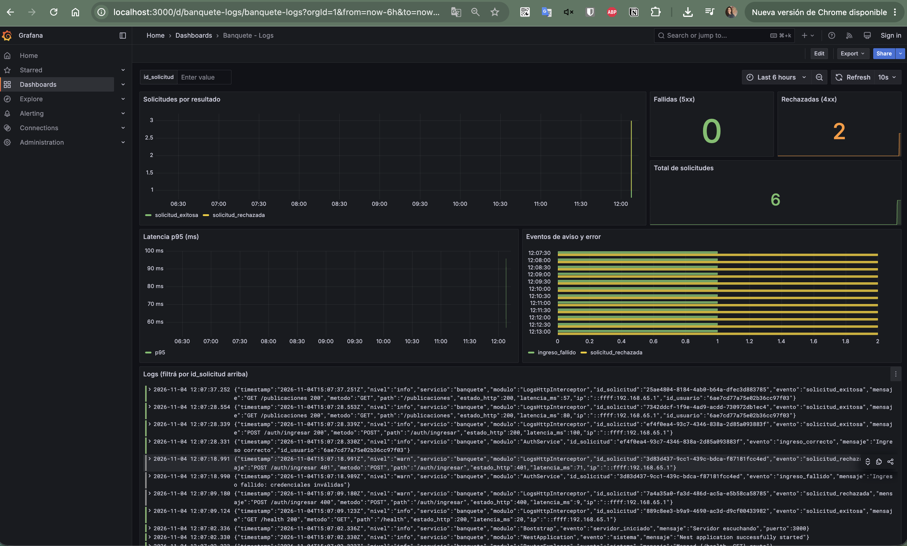

# Trabajo Practico Red Social

**Banquete**: red social culinaria para compartir experiencias, tips y todo lo que pasa en la cocina.

TP2 de Programación IV.
**UTN FRA | División 341 | 2026 C2**

**Profesores**

- Agustín Friadenrich
- Natalia Diez


---

## Indice

- [Aplicación en línea](#aplicación-en-línea)
- [Características técnicas](#características-técnicas)
- [Cómo correr el proyecto](#cómo-correr-el-proyecto)
- [Hooks de git](#hooks-de-git)
- [Variables de entorno](#variables-de-entorno)
- [Pipeline y despliegue](#pipeline-y-despliegue)
- [Sesión y borrador](#sesión-y-borrador)
- [Logs](#logs)
- [Estructura de carpetas](#estructura-de-carpetas)

---

## Aplicación en línea

| Pieza      | Dónde                       | Dirección                                                |
| ---------- | --------------------------- | -------------------------------------------------------- |
| Frontend   | Vercel                      | https://laura-carelli-tp-2-prog-4-2026-c2.vercel.app     |
| Backend    | Render                      | https://laura-carelli-tp2-prog4-2026-c2.onrender.com     |
| Base       | MongoDB Atlas               | Base `redsocial`                                         |
| Imágenes   | Cloudinary                  | Carpeta `banquete`                                       |

El plan gratis de Render duerme el backend tras unos minutos sin uso: el primera solicitud puede tardar hasta un minuto en responder.

---

## Características técnicas

| Pieza     | Versión                       |
| --------- | ----------------------------- |
| Angular   | 22.2.x                        |
| NestJS    | 12.x                          |
| MongoDB   | 8 (Docker)                    |
| Mongoose  | 9.x                           |
| Node      | 24 (LTS)                      |
| Tailwind  | 4.1.x                         |
| Vitest    | 4.x                           |
| Oxlint    | backend                       |
| ESLint    | frontend, con `angular-eslint` 22 |
| Prettier  | 3.x                           |

---

## Cómo correr el proyecto

Desde la raíz, una sola vez (usa Node 24 e instala los hooks de git y el commitlint):

```bash
nvm use
npm ci
```

Base de datos:

```bash
docker compose up -d mongo
```

Backend (`http://localhost:3001`):

```bash
cd backend
cp .env.example .env
npm ci
npm run start:dev
```

Frontend (`http://localhost:4200`):

```bash
cd frontend
npm ci
npm start
```

Backend y base juntos en contenedores:

```bash
docker compose up --build
```

| Comando (backend)    | Qué hace                              |
| -------------------- | ------------------------------------- |
| `npm run start:dev`  | Levantar desarrollo                   |
| `npm run build`      | Build de producción a `dist/`         |
| `npm test`           | Tests de unidad                       |
| `npm run test:cov`   | Tests de unidad con cobertura         |
| `npm run test:e2e`   | Tests de API contra Mongo             |
| `npm run test:e2e:cov` | Tests de API con cobertura          |
| `npm run lint`       | Oxlint sobre `src/` y `test/`         |
| `npm run format`     | Prettier da formateo                  |

| Comando (frontend) | Qué hace                      |
| ------------------ | ----------------------------- |
| `npm start`        | Levantar desarrollo           |
| `npm run build`    | Build de producción a `dist/` |
| `npm test`         | Tests en modo watch           |
| `npm run test:cov` | Tests con cobertura           |
| `npm run lint`     | ESLint sobre TypeScript y templates |

---

## Hooks de git

| Hook         | Qué hace                                                                         |
| ------------ | -------------------------------------------------------------------------------- |
| `pre-commit` | `lint-staged`: Oxlint y Prettier en `backend/`, ESLint y Prettier en `frontend/` |
| `commit-msg` | `commitlint`: tipos `feat`, `fix`, `docs`, `refactor`, `test`, `chore`           |
| `pre-push`   | Bloquea el push directo a `main`                                                 |

---

## Variables de entorno

Se definen en `backend/.env` (hay un ejemplo en `backend/.env.example`). El `.env` no se sube.

| Variable       | Para qué                                              |
| -------------- | ----------------------------------------------------- |
| `MONGO_URI`    | Conexión a MongoDB                                    |
| `PORT`         | Puerto del backend (3001 en local)                    |
| `FRONTEND_URL` | Origen permitido por CORS (por defecto `http://localhost:4200`) |
| `JWT_SECRET`   | Clave con la que se firma el token                    |
| `ADMIN_EMAIL`  | Correo que queda como administrador al registrarse    |
| `CLOUDINARY_API_KEY`, `CLOUDINARY_API_SECRET`, `CLOUDINARY_CLOUD_NAME` | Cuenta de Cloudinary donde se guardan las imágenes |
| `CLOUDINARY_CARPETA` | Carpeta raíz en Cloudinary (opcional, por defecto `banquete`). En desarrollo conviene otra, como `banquete-dev`, para no mezclar las fotos de prueba |
| `LIMITE_*` | Límites de solicitudes, todos opcionales. La lista está en [Límite de solicitudes](#límite-de-solicitudes) |

La URL de la API que usa el frontend está en `frontend/src/environments/`.

---

## Pipeline y despliegue

El flujo está en `.github/workflows/ci.yml`.

| Cuándo                | Qué corre                                                                                      |
| --------------------- | ---------------------------------------------------------------------------------------------- |
| Pull request a `main` | Lint, build y tests con cobertura del backend (contra un Mongo de servicio) y del frontend; commitlint sobre los mensajes |
| Merge a `main`        | Lo anterior y, si todo pasa, deploy del backend en Render (deploy hook) y del frontend en Vercel |

La cobertura de cada ejecución queda en el resumen del job y como archivo descargable.

---

## Sesión y borrador

La sesión usa un token JWT que dura **15 minutos** y se renueva mientras se usa la aplicación. Vence 15 minutos después de que la persona deja de usarla.

| Qué | Cómo funciona |
| --- | --- |
| Renovación | `POST /auth/refrescar` (con token válido) devuelve un token nuevo de 15 minutos para el mismo usuario y perfil. Un token ya vencido responde `401` y no se puede renovar |
| Mientras se usa la app | Un servicio del frontend (`servicios/sesion`) marca como uso los clics, las teclas, el scroll y los toques. Cada minuto, si hubo uso desde la última renovación, pide un token nuevo. Sin uso no renueva, así que la sesión vence sola |
| En "Nueva publicación" | La pantalla renueva al entrar, cada 5 minutos y al volver a mostrar la pestaña, aunque no haya teclas: siempre quedan al menos 10 minutos de sesión |
| Verificar la sesión | `POST /auth/autorizar` (con token válido) devuelve los datos actuales del usuario, sin la clave, leídos de la base. Responde `401` si falta el token, es inválido o venció, y `401` con `USUARIO_NO_AUTORIZADO` si el usuario ya no existe o está deshabilitado. No entrega un token nuevo |
| Duración máxima | Cada token lleva `inicio`, la hora del ingreso, y se conserva al renovar. Pasadas **12 horas** desde el ingreso, `refrescar` responde `401` con el código `SESION_VENCIDA` y hay que ingresar de nuevo |

**Borrador de una publicación.** Todo lo que se escribe en "Nueva publicación" se guarda solo en el navegador (`localStorage`, clave `borrador:<id del usuario>`), con una pausa de 0,8 segundos después de la última tecla, al salir de la pantalla, al ocultar o cerrar la pestaña y al recargar. Al volver a entrar se recupera con un aviso y la opción de descartarlo; al publicar se borra.

- Guarda tipo, título, mensaje, ficha, costo, ingredientes y pasos en `localStorage`. La foto de portada y las de los pasos van aparte, en IndexedDB (`banquete` / `fotos-borrador`): guarda los archivos tal cual, sin convertirlos a texto, así no choca con el límite de unos 5 MB de `localStorage`. Si el navegador no tiene IndexedDB, el borrador sigue funcionando sin fotos.
- Cada usuario tiene el suyo; no se mezclan en un mismo navegador.
- Lo que se lee del almacenamiento se valida otra vez (tipos, medidas, máximos, solo dígitos en la ficha), porque `localStorage` se puede modificar a mano.
- Si la sesión ya venció, la pantalla avisa, mantiene el borrador y ofrece "Ingresar de nuevo".

**Tests:** `backend/test/autorizar.e2e-spec.ts` (datos actuales, sin clave, usuario inexistente o deshabilitado, tokens inválidos), `backend/test/refrescar.e2e-spec.ts` (renovación, duración, `inicio` constante, tope de 12 horas, tokens vencidos o firmados con otra clave), `servicios/sesion/sesion.spec.ts`, `servicios/borrador/borrador.spec.ts`, `servicios/fotos-borrador/fotos-borrador.spec.ts` y `pages/nueva-publicacion/nueva-publicacion.spec.ts`.

---

## Logs

El backend escribe **una línea de JSON por evento** en la salida estándar, en local y en producción. Render las junta y de ahí pueden salir hacia Grafana (Loki) sin transformarlas. Todo el código, incluidos los mensajes de arranque de Nest, sale con el mismo formato.

```json
{
  "timestamp":"2026-11-03T14:20:11.512Z",
  "nivel":"info",
  "servicio":"banquete",
  "modulo":"LogsHttpInterceptor",
  "id_solicitud":"7f0c2b1e-4a53-4f0e-9d1a-0c5e8a2b6d11",
  "evento":"solicitud_exitosa",
  "mensaje":"POST /auth/ingresar 201",
  "metodo":"POST",
  "path":"/auth/ingresar",
  "estado_http":201,
  "latencia_ms":84,
  "ip":"203.0.113.7",
  "id_usuario":"665f1c..."
}
```

### Campos

| Campo            | Qué es                                                                              |
| ---------------- | ----------------------------------------------------------------------------------- |
| `timestamp`      | Fecha y hora en ISO 8601 (UTC)                                                      |
| `nivel`          | `info`, `warn` o `error`                                                            |
| `servicio`       | Nombre fijo (`banquete`), para filtrar si hay más de un servicio                    |
| `modulo`         | Clase que escribió el log; sale del nombre de la clase que lo crea                  |
| `id_solicitud`   | Identificador que une todos los logs de una misma solicitud HTTP                    |
| `evento`         | Nombre estable del hecho (`ingreso_fallido`, `imagen_subida`, `solicitud_exitosa`...) |
| `mensaje`        | Texto legible para una persona                                                      |
| resto            | Campos específicos de cada evento (`id_usuario`, `nombre_usuario`, `estado_http`, `latencia_ms`...) |

Las claves siempre salen en ese orden y en `snake_case`, para que las consultas de Grafana usen los mismos nombres en todos lados.

### Quién hizo qué

Toda línea que corresponde a una persona trae su `id_usuario` **y** su `nombre_usuario`, para identificarla de un vistazo sin buscar el id. El nombre viaja en el token y, para los eventos de negocio, se confirma contra la base.

| Evento                    | Campos de negocio                                                                                   |
| ------------------------- | --------------------------------------------------------------------------------------------------- |
| `usuario_registrado`      | `id_usuario`, `nombre_usuario`, `perfil`                                                            |
| `ingreso_correcto`        | `id_usuario`, `nombre_usuario`                                                                      |
| `publicacion_creada`      | `id_publicacion`, `id_usuario`, `nombre_usuario`, `tipo`                                            |
| `publicacion_eliminada`   | `id_publicacion`, `id_usuario`, `nombre_usuario`, `id_autor`, `nombre_autor`, `por_administrador`   |
| `me_gusta_dado`           | `id_publicacion`, `id_usuario`, `nombre_usuario`, `id_autor`, `nombre_autor`, `cantidad_me_gusta`   |
| `me_gusta_quitado`        | los mismos, con la cantidad que quedó                                                               |

La línea del evento y la línea HTTP de la misma solicitud comparten `id_solicitud` (la HTTP trae además la IP).

### Historial de me gusta

Los logs sirven para auditar, pero se pierden. Para poder sacar métricas, cada me gusta dado o quitado queda también como un documento en la colección **`eventos_megusta`**, que **sólo se agrega y nunca se modifica ni se borra**. La colección `megusta` sólo guarda los me gusta vigentes; ésta guarda toda la historia.

| Campo               | Qué es                                                        |
| ------------------- | ------------------------------------------------------------- |
| `tipo`              | `dado` o `quitado`                                            |
| `usuario`, `nombreUsuario`   | Quién lo hizo                                        |
| `publicacion`, `tituloPublicacion` | A qué publicación, con el título de ese momento |
| `autor`, `nombreAutor`       | Quién es el autor de la publicación                  |
| `cantidadMeGusta`   | Cuántos me gusta tenía la publicación justo después          |
| `fecha`             | Cuándo                                                        |

Los nombres se copian en cada evento, así la información queda legible aunque cambie el título o se dé de baja la publicación. Si guardar el evento falla, el me gusta se guarda igual y queda una línea de error `evento_me_gusta_no_registrado`.

Consultas de ejemplo en `mongosh`:

```js
// Me gusta dados por día
db.eventos_megusta.aggregate([
  { $match: { tipo: 'dado' } },
  { $group: { _id: { $dateToString: { format: '%Y-%m-%d', date: '$fecha' } }, total: { $sum: 1 } } },
  { $sort: { _id: 1 } }
])

// Cuántos me gusta recibió cada autor (dados menos quitados)
db.eventos_megusta.aggregate([
  { $group: { _id: '$nombreAutor', neto: { $sum: { $cond: [{ $eq: ['$tipo', 'dado'] }, 1, -1] } } } },
  { $sort: { neto: -1 } }
])

// Cuándo y quién dio y quitó me gusta en una publicación
db.eventos_megusta.find({ publicacion: ObjectId('...') }).sort({ fecha: 1 })
```

### Niveles

| Nivel   | Cuándo                                                                      |
| ------- | --------------------------------------------------------------------------- |
| `info`  | Funcionamiento normal: respuestas 2xx y 3xx, ingreso correcto, imagen subida |
| `warn`  | El cliente hizo algo mal: respuestas 4xx, ingreso fallido, token rechazado, límite superado |
| `error` | Falló el servidor: respuestas 5xx, errores no controlados                    |

### Arquitectura

Todo vive en `backend/src/logs/`.

| Pieza                    | Archivo                      | Qué hace                                                                                         |
| ------------------------ | ---------------------------- | ------------------------------------------------------------------------------------------------ |
| `LoggerGlobal`           | `logger-global.ts`           | Implementa el `LoggerService` de Nest. Se pasa a `NestFactory.create`, así los logs internos de Nest salen con el mismo formato. También arma y escribe la línea JSON (`crearLog`, `emitirLog`) |
| `LoggerFactory`       | `logs.factory.ts`            | Proveedor global. `crear('NombreDeClase')` devuelve un logger ya asociado a ese módulo           |
| `ContextLogger`          | `logs.factory.ts`            | Logger que usan los servicios: `info`, `advertir` y `error`, cada uno con `evento`, `mensaje` y campos extra |
| `EVENTOS_DE_LOG`         | `logs.factory.ts`            | Catálogo de nombres de evento, para que no se escriban a mano                                    |
| `asignarIdSolicitud`     | `id-solicitud.middleware.ts` | Middleware que le da un id a cada solicitud y lo guarda en un `AsyncLocalStorage`                |
| `LogsHttpInterceptor`    | `logs-http.interceptor.ts`   | Registra una línea por solicitud respondida: método, path, estado, latencia, IP y usuario        |
| `LogsModule`             | `logs.module.ts`             | Módulo `@Global()`: registra la fábrica, el interceptor (`APP_INTERCEPTOR`) y aplica el middleware a todas las rutas |

Cómo se usa en un servicio:

```ts
constructor(loggerFactory: LoggerFactory) {
  this.logger = loggerFactory.crear(AuthService.name);
}

this.logger.info(EVENTOS_DE_LOG.INGRESO_CORRECTO, 'Ingreso correcto', { id_usuario });
```

### Cómo viaja una solicitud

1. Llega la solicitud y el middleware toma el encabezado `X-Request-Id` si tiene entre 8 y 64 caracteres alfanuméricos, guiones o guiones bajos; si no, genera un UUID. Lo devuelve en el mismo encabezado de la respuesta.
2. El id queda guardado en un `AsyncLocalStorage` durante toda la solicitud. Por eso los servicios no lo reciben por parámetro: `crearLog` lo lee solo.
3. Los guards y servicios escriben sus eventos. Todos salen con el mismo `id_solicitud`.
4. Al responder, el interceptor escribe la línea de la solicitud: `solicitud_exitosa` (2xx y 3xx), `solicitud_rechazada` (4xx) o `solicitud_fallida` (5xx). El `path` no incluye los parámetros de consulta (`?...`), para no guardar datos que viajen ahí.

Los interceptores corren después de los guards. Cuando un guard rechaza la solicitud (401 o 429), el interceptor no llega a verla, así que `AuthGuard` (`token_ausente`) y `LimiteSolicitudesGuard` (`limite_superado`) escriben cada uno su `warn`.

### Qué no se escribe

Los logs no incluyen claves, tokens, el encabezado `Authorization`, cadenas de conexión, claves de API ni el cuerpo de las solicitudes. De las personas solo se registra su `id_usuario`, nunca el correo.

### Ver los logs en Grafana (local)

`docker-compose.yml` incluye tres servicios para mirar los logs del backend que corre en Docker:

| Servicio  | Qué hace                                                                 |
| --------- | ------------------------------------------------------------------------ |
| `alloy`   | Lee la salida de los contenedores del servicio `backend` y la manda a Loki |
| `loki`    | Guarda los logs                                                          |
| `grafana` | Los muestra en `http://localhost:3000` (sin login, solo para uso local)  |

```bash
docker compose up --build
```

El dashboard **Banquete - Logs** ya viene cargado: solicitudes por resultado (`solicitud_exitosa`, `solicitud_rechazada`, `solicitud_fallida`), cantidad de fallidas y rechazadas, latencia p95, eventos de aviso y error, y la lista de logs. En la variable `id_solicitud` de arriba se pega un id para ver todo lo que pasó en esa solicitud.



En *Explore* se pueden hacer consultas libres con LogQL. Por ejemplo, los ingresos fallidos:

```
{service_name="backend"} | json | evento="ingreso_fallido"
```

Solo se ven los logs del backend levantado con Docker Compose, no los del `npm run start:dev` ni los de Render. La configuración está en `grafana/`.

### Límite de solicitudes

Se usa `@nestjs/throttler`. Cada IP tiene dos contadores que corren juntos, y alcanza con pasarse de uno para recibir el `429`:

| Nombre      | Para qué sirve                                              | Ventana por defecto |
| ----------- | ----------------------------------------------------------- | ------------------- |
| `burst`     | Frena ráfagas: muchas solicitudes en muy poco tiempo        | 1 segundo           |
| `sustained` | Frena el uso excesivo sostenido: muchas solicitudes en un rato | 60 segundos      |

**Valores por defecto**

| Rutas                               | `burst`        | `sustained`                                        |
| ----------------------------------- | -------------- | -------------------------------------------------- |
| Todas (general)                     | 10 por segundo | 120 por minuto                                     |
| `POST /auth/ingresar` y `POST /auth/registro` | 3 por segundo | 10 por minuto. Al pasarse, la IP queda **bloqueada 5 minutos** |
| `GET /health`                       | sin límite     | sin límite                                         |

El bloqueo de 5 minutos existe porque ingreso y registro son los blancos de los intentos de adivinar claves: pasarse del límite sostenido castiga más que pasarse del burst, que solo espera un segundo. Como las dos rutas comparten el contador, una IP bloqueada en el ingreso tampoco puede registrarse durante ese tiempo.

**Variables de entorno** (todas opcionales; si falta alguna vale el número por defecto)

| Variable                                | Por defecto | Qué cambia                                              |
| --------------------------------------- | ----------- | ------------------------------------------------------- |
| `LIMITE_BURST_SEGUNDOS`                 | 1           | Ventana del `burst`, en todas las rutas con límite      |
| `LIMITE_BURST_SOLICITUDES`              | 10          | Máximo del `burst` en el resto de las rutas             |
| `LIMITE_SUSTAINED_SEGUNDOS`             | 60          | Ventana del `sustained`, en todas las rutas con límite  |
| `LIMITE_SUSTAINED_SOLICITUDES`          | 120         | Máximo del `sustained` en el resto de las rutas         |
| `LIMITE_INGRESO_BURST_SOLICITUDES`      | 3           | Máximo del `burst` en ingreso y registro                |
| `LIMITE_INGRESO_SUSTAINED_SOLICITUDES`  | 10          | Máximo del `sustained` en ingreso y registro            |
| `LIMITE_INGRESO_BLOQUEO_SEGUNDOS`       | 300         | Duración del bloqueo al pasarse del `sustained` en ingreso y registro |

| Variable                                | Por defecto | Qué cambia                                              |
| --------------------------------------- | ----------- | ------------------------------------------------------- |

**Cómo está armado**

- `backend/src/configs/throttler.config.ts` define las tres piezas: `LIMITES_GENERALES` (los dos contadores, registrados en `ThrottlerModule.forRoot`), `LIMITES_AUTENTICACION` (se aplica con `@Throttle` en `ingresar` y `registro`) y `SIN_LIMITES` (se aplica con `@SkipThrottle` en `HealthController`).
- Los valores son funciones que leen la variable en cada solicitud, porque los decoradores de los controladores se evalúan antes de que se cargue el `.env`.
- `LimiteSolicitudesGuard` (`backend/src/common/`) extiende el `ThrottlerGuard` de la librería y se registra como guard global con `APP_GUARD`. Agrega el código de error, el encabezado `Retry-After` estándar y un log `limite_superado`.
- Se cuenta por IP. Como en Render hay un proxy delante, `main.ts` configura `trust proxy` para tomar la IP real del cliente y no la del proxy.
- Los contadores viven en memoria: se reinician con cada deploy o reinicio. Sirve mientras haya una sola instancia del backend; con varias haría falta un almacenamiento compartido, como Redis.

**Qué recibe el cliente al pasarse**

```
HTTP/1.1 429 Too Many Requests
Retry-After: 300
Retry-After-sustained: 300
```

```json
{ "message": "Demasiadas solicitudes, espera un momento", "codigo": "DEMASIADAS_SOLICITUDES" }
```

- `Retry-After` son los segundos que hay que esperar. La librería suma además `Retry-After-burst` o `Retry-After-sustained`, según el contador que se superó.
- El frontend traduce el `codigo` (`DEMASIADAS_SOLICITUDES`) a un mensaje en el idioma elegido; no muestra el texto de `message`.

**Tests** (`backend/test/limites.e2e-spec.ts`): el cuarto ingreso en un segundo responde `429`; la respuesta trae el código y `Retry-After`; el registro tiene el mismo límite; pasado un segundo vuelve a aceptar; más de 10 intentos en un minuto bloquean más de un minuto; el resto de las rutas admite 10 por segundo y `/health` no tiene ninguno.

---

## Estructura de carpetas

```
.
├── backend/                  NestJS
│   └── src/
│       ├── auth/
│       ├── common/           Guard de límite de solicitudes y DTOs compartidos
│       ├── configs/          Límites de solicitudes
│       ├── health/           GET /health
│       ├── imagenes/
│       ├── logs/             Logs estructurados e id de solicitud
│       ├── publicaciones/
│       ├── usuarios/
│       ├── app.module.ts
│       ├── main.ts
│       └── validacion-global.ts
├── frontend/                 Angular
│   └── src/
│       ├── app/
│       └── environments/
├── grafana/                  Alloy, fuente de datos y dashboard de logs
├── .husky/                   Hooks de git
├── .nvmrc
├── commitlint.config.js
├── package.json              Solo herramientas del repo
└── docker-compose.yml        Mongo y backend
```
